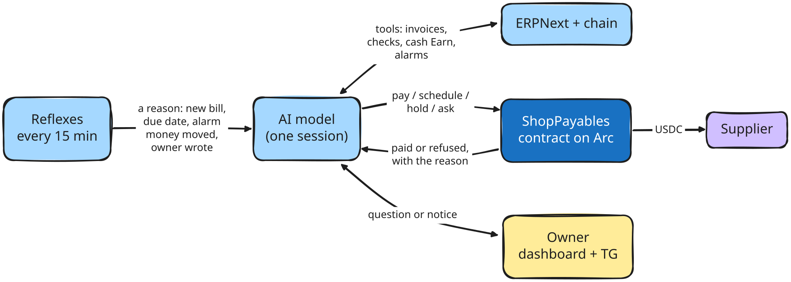
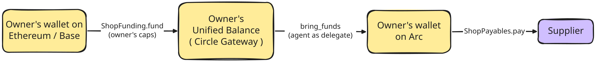
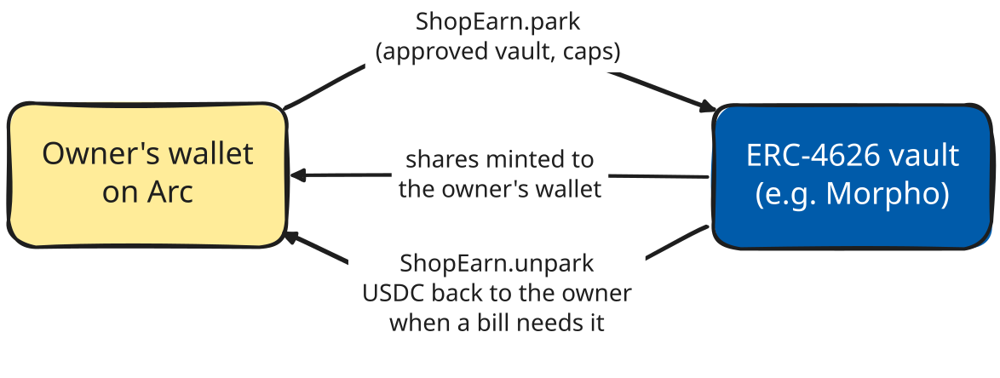

<div align="center">


# embco

**The payables agent for the ERPNext you already run.**

It reads your purchases, decides what to pay and when, pays suppliers in USDC on Arc itself,
and acts on what happened. A smart contract sets the limits it cannot cross.

[**Documentation**](https://jadi03.github.io/embco/) ·
[**Dashboard**](https://app.embco.xyz) ·
[How it works](https://jadi03.github.io/embco/how-it-works/) ·
[Connect your ERPNext](https://jadi03.github.io/embco/connect/)

[](https://github.com/JaDi03/embco/actions/workflows/ci.yml)
[](https://jadi03.github.io/embco/)

[](LICENSE)

</div>

> Built for the Tameion Agents Hackathon (Canteen x Circle, on Arc). Early and built in public:
> the agent runs against a live ERPNext and pays on Arc Testnet.

## What it does

- **Checks** every invoice against its order and receipt, its price history and the contract's
  limits. Only an unproven supplier wallet or a duplicate bill stops it outright.
- **Decides**, with an AI model that weighs what the checks found: pay now, pay on a date,
  hold, or ask the owner, each with a written reason.
- **Pays** itself in USDC, through a shop contract on Arc that holds the owner's limits, then
  reads the result: the transaction, or the contract's or Circle's own error. When something
  stops a payment, it looks up why and tells the owner what only they can fix. Every payment is
  recorded back in ERPNext.
- **Talks** with the owner on the dashboard and on Telegram: questions, instructions, notices.
- **Learns** what the owner tells it and how each supplier behaves, in a few short memory files
  it reads every time it is woken.
- **Records** every decision and answer in a hash-chained journal that nobody can rewrite
  unnoticed.

## How it works

### The agent: the model decides, the contract holds the limits

<picture>
  <source media="(prefers-color-scheme: dark)" srcset="docs/assets/diagrams/readme-agent-dark.svg">
  
</picture>

1. Code only decides **when** to wake the model: a new or changed bill, a due date, an alarm the
   model set, the owner's money moving, a message or an answer, a supplier signing for its
   wallet or getting an email in the ERP, or the daily round. No reason, no session.
2. The model decides **what** to do, using tools: read the invoice and its checks, look at the
   cash on every chain, bring funds, park or withdraw from Earn, pay, schedule, hold, or ask.
3. It sees what came back (the transaction, or the contract's or Circle's error) and acts on it.
   Every payment is recorded back in ERPNext and every decision in the journal.

| The AI model decides | Code enforces, and the model cannot change |
|---|---|
| Whether, when and how much to pay | Per-payment and weekly caps, in the owner's contract |
| Where the money comes from (Arc, Earn, other chains) | Only approved supplier wallets, once per invoice |
| What to park in Earn, and when to take it back | Only owner-approved vaults, within park limits |
| What to ask the owner, and every word it writes | Unproven wallets and duplicate bills are blocked |

### Cross-chain funds: the owner's USDC on other chains, via Circle Gateway

<picture>
  <source media="(prefers-color-scheme: dark)" srcset="docs/assets/diagrams/readme-cross-chain-dark.svg">
  
</picture>

When the wallet on Arc runs short, the model estimates the fees, moves the owner's USDC into their
Gateway balance and brings it to their wallet on Arc. It only ever lands in the owner's own wallet.

### Earn: idle USDC earns yield, with zero custody

<picture>
  <source media="(prefers-color-scheme: dark)" srcset="docs/assets/diagrams/readme-earn-dark.svg">
  
</picture>

USDC and vault shares never sit in an embco contract. The owner picks the vaults and the limits;
the model picks when and how much, following the owner's liquidity strategy.

## Contracts on Arc Testnet

| Contract | What it does | Address |
|---|---|---|
| `ShopPayablesFactory` | Each owner creates their shop contract: the agent pays suppliers from the owner's wallet within the owner's limits | [`0x5D455dF984C85abe160E4585E0c1139ded5d2c3b`](https://explorer.testnet.arc.io/address/0x5D455dF984C85abe160E4585E0c1139ded5d2c3b) |
| `ShopEarnFactory` | Each owner creates their ShopEarn: the agent parks idle USDC in approved vaults and takes it back, shares stay with the owner | [`0xEDF589982F10CCC3c8489726FaB39124b1F683Aa`](https://explorer.testnet.arc.io/address/0xEDF589982F10CCC3c8489726FaB39124b1F683Aa) |
| `JournalAnchor` | The Merkle root of each shop's journal, written by its agent, so any copy can be checked | [`0x4385a2F8acda166F3FE3B3825F6950BA7dAc2582`](https://explorer.testnet.arc.io/address/0x4385a2F8acda166F3FE3B3825F6950BA7dAc2582) |
| `ShopFundingFactory` (Base Sepolia, Ethereum Sepolia) | Each owner creates their ShopFunding: the agent deposits the owner's USDC into the owner's own Unified Balance | [`0x69e31Af302Ee222204AA78099D39a2956F5C95d6`](https://sepolia.basescan.org/address/0x69e31Af302Ee222204AA78099D39a2956F5C95d6) |

Every contract, who can call what, and the vaults: [Smart contracts](https://jadi03.github.io/embco/contracts/).

Why it exists: [Agents and Ledgers in 2026](https://thecanteenapp.com/analysis/2026/09/12/agents-and-ledgers.html).
How each part works, with diagrams: [the documentation](https://jadi03.github.io/embco/).

## Built with

| Layer | Technology |
|---|---|
| Agent |     |
| Chain |     |
| ERP |   |
| Owner apps |     |
| Tooling |      |

## Project structure

```
embco/
├── agent/               the agent: its brain and the checks it cannot skip
│   ├── agent.py         the brain: the AI model decides, pays and acts on the result
│   ├── think.py         one session: wake the model, run it, remember the result
│   ├── plan.py          turns the decisions into the cycle's payment plan
│   ├── models.py        what the agent decides, and what it keeps for the next session
│   ├── prompt.py        the briefing the model reads
│   ├── cost.py          estimates what a session cost
│   ├── wiring.py        builds the agent from the settings
│   ├── tools/           what the agent can read and do
│   ├── reflexes/        what wakes it, and the cycle every 15 minutes
│   ├── guardrails/      the controls, the fixed rule (HOLD, ASK, notes) and the gate
│   ├── memory/          the hash-chained journal and the agent's memory files
│   └── explain/         plain-language explanations for the owner
├── services/            what the agent stands on
│   ├── erp/             the ERPNext adapter
│   ├── circle/          Circle developer-controlled wallets (EOA and smart contract accounts)
│   ├── earn/            Arc Earn integration: zero-custody idle USDC yield in ERC-4626 vaults
│   ├── unified_balance/ the owner's Unified Balance (Circle Gateway), through Circle's kit
│   ├── payments/        simulate on Arc, send, follow, record
│   ├── hub/  shops/     the hosted service behind the dashboard
│   ├── signing/         supplier wallet signatures
│   ├── telegram/        the Telegram bot
│   ├── settings.py      settings from the environment, checked once
│   └── cli.py           the embco command
├── contracts/           ShopPayables, ShopFunding, ShopEarn, their factories and JournalAnchor (Solidity, Arc Foundry)
├── dashboard/           the owner dashboard and the supplier page (static, MetaMask)
├── connector/           prepares an ERPNext instance
├── deploy/              install.sh and the server files it sets up
├── docs/                the documentation site (MkDocs)
└── tests/               tests for the agent and the services
```

## Circle tools

| Tool | What embco does with it |
|---|---|
| Wallets: developer-controlled wallets | Creates each shop's agent wallets (a smart contract account that sends payments, and an EOA that signs Unified Balance spends) and signs every transaction, with idempotency keys |
| Wallets: Gas Station | Pays the network fees of the agent's smart contract account, so the owner never sends it gas |
| Unified Balance Kit (`@circle-fin/unified-balance-kit`) | Moves the owner's USDC from other chains into their Unified Balance and brings it to their wallet on Arc, with the fees estimated first |
| Gateway | Holds the owner's Unified Balance; the `ShopFunding` contract deposits into it for the owner |
| Arc Earn (ERC-4626) | Parks the owner's idle USDC on Arc into owner-approved vaults (e.g. Morpho) and unparks it to pay invoices, zero custody |
| USDC and Arc | The currency the suppliers are paid in, and the chain where the shop contract runs |

## Getting started

### Use ours

No installation. Open the [dashboard](https://app.embco.xyz), connect your wallet, create your
shop contract, and follow [Connect your ERPNext](https://jadi03.github.io/embco/connect/).

### Run your own

The same dashboard and agents on your own server (Ubuntu or Debian, with a domain):

```bash
git clone https://github.com/JaDi03/embco.git
cd embco
cp .env.example .env
nano .env                       # your domain, an Arc node URL, Circle and Anthropic keys
sudo bash deploy/install.sh
```

Then shops connect through your dashboard, as they do on ours. Details:
[Run your own server](https://jadi03.github.io/embco/server/).

<details>
<summary>Tests: agent, contracts, dashboard and docs</summary>

```bash
uv run ruff check . && uv run pytest -q
```

The contracts use [Arc Foundry](https://github.com/circlefin/arc-foundry) (Linux and macOS; on
Windows, WSL):

```bash
cd contracts
arc-forge test                                                                 # unit and fuzz tests
ARC_TESTNET_RPC_URL=https://rpc.testnet.arc.io arc-forge test --network arc    # plus the Arc fork test
```

The dashboard has no build step:

```bash
cd dashboard && node --test
```

The documentation site, locally:

```bash
uv run --no-project --with-requirements requirements-docs.txt mkdocs serve
```

</details>

## License

[MIT](LICENSE)
